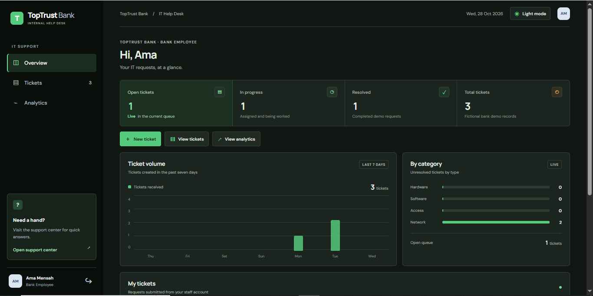

# TopTrust Bank Help Desk

A fictional IT service desk ticketing app built for a development portfolio. Employees can submit and track support requests; IT staff can manage, assign, and resolve them.

> **Demo project:** TopTrust Bank, its staff, and all ticket data are fictional. Do not use this app for real banking or customer information.



## Features


- Role-based sign-in for employees, IT agents, and administrators
- Create and track IT support tickets
- Search and filter the ticket queue
- Assign tickets and update their priority and status
- Save ticket data in a local SQLite database
- Dashboard analytics and CSV export
- Dark mode

## Technology

- React, TypeScript, and Vite
- Node.js and Express
- SQLite

## Run locally

Requirements: Node.js and npm.

Open two VS Code terminals from the project folder.

**Terminal 1 — API**

```powershell
cd server
npm.cmd install
node index.js
